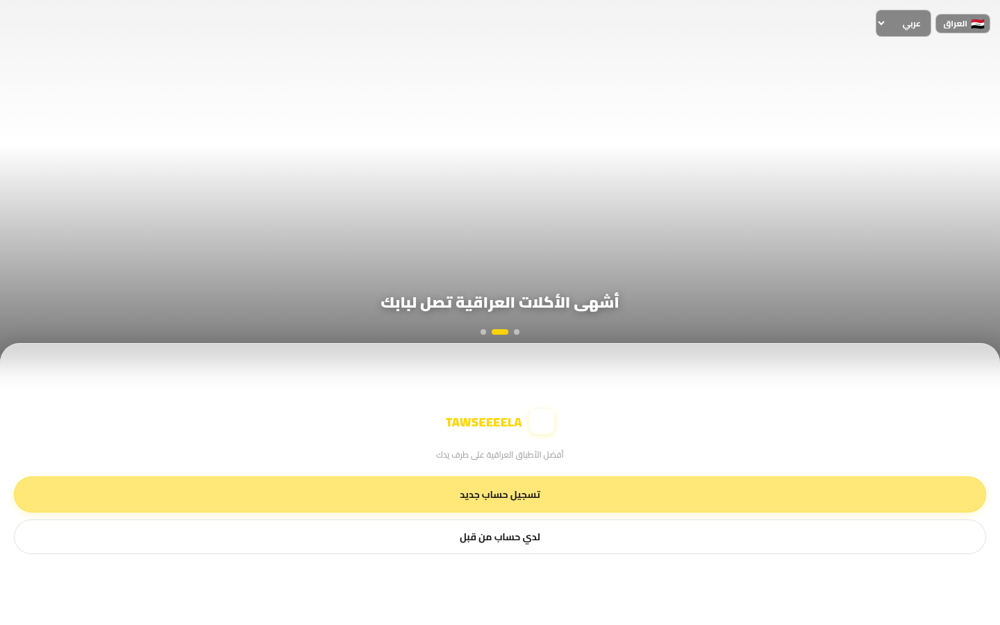

# 🛵 Tawseela

**A delivery super-app for Iraq and Egypt — restaurants, groceries and packages in three languages.**

## 📖 Overview

Tawseela is a delivery super-app built for Iraq and Egypt, with full Arabic, English and Kurdish interfaces. Customers register with their phone number, choose a delivery address, then order from restaurants, groceries or wholesale stores — or send a package across the city. Live offers, restaurant ratings, transparent delivery fees and a native-feeling tab bar make it feel at home on any phone.

## ✨ Features

- 📞 **Phone-number registration** across Iraq and Egypt
- 🚀 **Four verticals** — restaurants, groceries, wholesale and packages
- 🌍 **Trilingual interface** — Arabic, English and Kurdish
- 🏷️ **Live offers, ratings** and transparent delivery fees
- 📱 **Native-style mobile experience** with tab navigation

## 🧱 Tech Stack

`Next.js` · `Mobile UX` · `i18n` · `Auth` · `Realtime`

## 🌐 Live Product

**Try it now:** [https://tawseela-demo.vercel.app/](https://tawseela-demo.vercel.app/)

---

Built by **[Hamza Talal](https://github.com/{USERNAME})** — 15-year-old full-stack developer from Egypt

